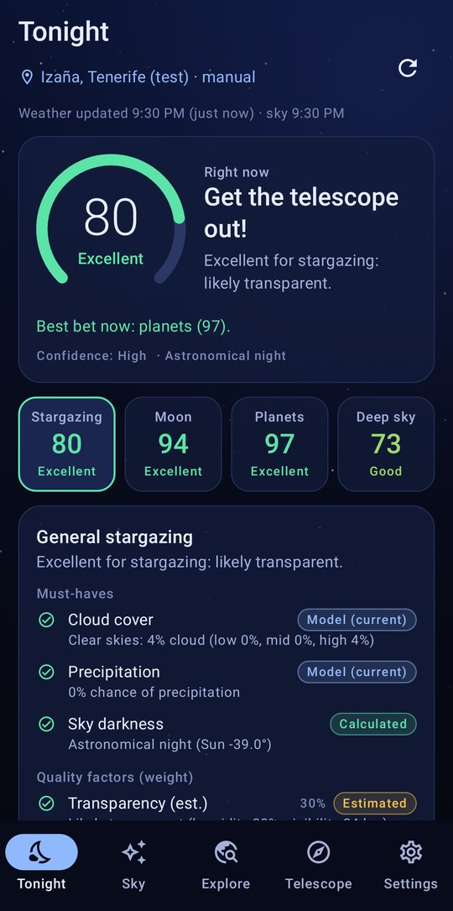
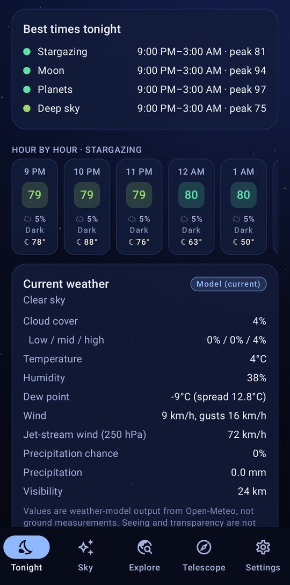
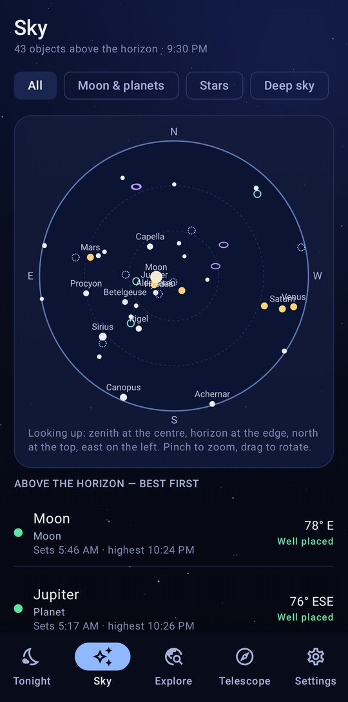
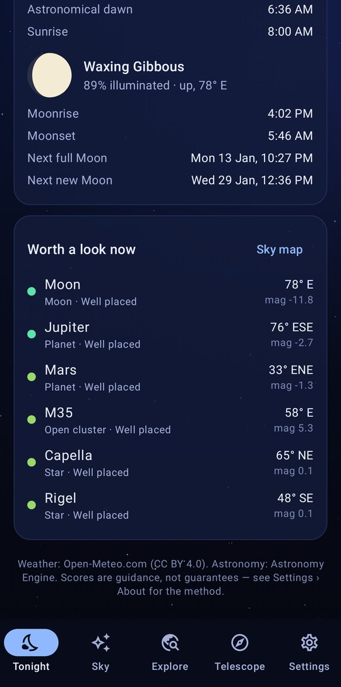

# Polaris ✦

**A stargazing companion for Android: is tonight worth taking the telescope out?**

Polaris combines a live weather forecast with on-device astronomy to give separate, explained
0–100 scores for **general stargazing, the Moon, planets and deep-sky objects**. It also shows
what is well placed in your sky right now and includes an experimental phone-sensor
**push-to** assistant.

<p>




</p>

<sub>Screenshots are rendered by the automated UI test (`ScreenRenderTest`) with a test-only
fixture forecast for Izaña, Tenerife on 2025-01-10 21:30 UTC. The astronomy in them is real.</sub>

## Features (v0.1.0)

**Tonight** (main screen)
- Current score and verdict ("Get the telescope out!" … "Not tonight") with a confidence level.
- Four assessments: General · Moon · Planets · Deep sky. Each shows its *must-haves*
  (cloud, precipitation, darkness, target up) and its weighted quality factors (transparency,
  seeing, wind, dew, moonlight, light pollution, altitude, lunar phase). Every factor is labelled
  with its data source: *Model (current) / Forecast / Estimated / Calculated / User-provided /
  Unavailable*.
- Best observing windows tonight, plus an hour-by-hour strip until sunrise.
- Current weather: total/low/mid/high cloud, temperature, humidity, dew point and spread, wind and
  gusts, jet-stream wind, precipitation chance and amount, visibility.
- Sun & Moon: sunset, civil/nautical/astronomical dusk and dawn, sunrise, polar day/night handling,
  Moon phase drawing, illumination, rise/set, next full and new Moon.
- "Worth a look now": the top objects ranked by realistic observability.
- Last-updated time, loading/error/offline states, cached-data banners, pull-to-refresh.

**Sky**: interactive polar sky map (zenith at the centre; tap, pinch and drag), type filters, and
every object above the horizon ranked by observability.

**Explore**: search ("M31", "Saturn", "galaxy", "NGC 5139") and browse about 85 objects (Sun,
Moon, 7 planets, 35 bright stars and doubles, 37 deep-sky objects). The detail sheet shows
altitude/azimuth, RA/Dec, magnitude, size, Moon separation, rise/transit/set and observing notes.

**Telescope (experimental)**: live orientation from rotation-vector or accelerometer+magnetometer
sensors, magnetic declination correction, compass-accuracy and interference warnings, a
phone-mount axis choice, one-star alignment and a push-to guide (Δaz/Δalt plus separation).
Accuracy limits are stated plainly. It degrades gracefully on devices without sensors.

**Settings**: device or manual location (place search or coordinates), Bortle class, metric or
imperial units, auto-refresh, and an About section with the method and attributions.

## How the score works (short version)

```
score = 100 × Π(gates) × weighted mean of quality factors (with available data)
```
Gates (cloud, precipitation, darkness, target above the horizon) act as show-stoppers. Quality
factors are weighted per observing type: seeing dominates planets, while transparency, moonlight
and light pollution dominate deep-sky. Missing data is excluded and flagged, never assumed ideal.
Seeing and transparency are **estimates** because no public weather API measures them.

- Full method: [docs/STARGAZING_SCORING.md](docs/STARGAZING_SCORING.md)
- Science & sources: [docs/ASTRONOMY_RESEARCH.md](docs/ASTRONOMY_RESEARCH.md)
- Code structure: [docs/ARCHITECTURE.md](docs/ARCHITECTURE.md)

## Install the APK

1. Download `polaris-v0.1.0.apk` (signed release build) from the
   [Releases page](https://github.com/JimTheFatJam/claude-open-polaris/releases).
2. On your phone, allow installs from your browser/file manager
   (*Settings › Apps › Special access › Install unknown apps*).
3. Open the APK and install it. Requires Android 8.0 (API 26) or newer.

Or install it over USB with `adb install -r polaris-v0.1.0.apk`. A debug build
(`polaris-v0.1.0-debug.apk`, app id `io.github.jimthefatjam.polaris.debug`) is attached too.

## Build from source

### Android Studio
1. Install Android Studio (Ladybug 2024.2 or newer) with SDK Platform 35.
2. *File › Open…* and choose the repository folder.
3. Let Gradle sync (it uses the bundled Gradle wrapper and JDK 17+).
4. Choose the `app` run configuration and a device or emulator, then press **Run ▶**.

### Command line
```bash
# JDK 17+ and an Android SDK (platform 35, build-tools 35) are required.
echo "sdk.dir=/path/to/Android/sdk" > local.properties   # or set ANDROID_HOME

./gradlew :core:test              # astronomy, scoring, weather, telescope unit tests (fast, pure JVM)
./gradlew :app:testDebugUnitTest  # Robolectric UI render/smoke test (writes app/build/screenshots/)
./gradlew assembleDebug           # → app/build/outputs/apk/debug/app-debug.apk
```

### Release signing
No keystore is committed. `app/build.gradle.kts` signs release builds when these environment
variables are set: `ANDROID_KEYSTORE_PATH`, `ANDROID_KEYSTORE_PASSWORD`, `ANDROID_KEY_ALIAS`,
`ANDROID_KEY_PASSWORD`. CI (`.github/workflows/android.yml`) gets them from the repository secrets
`ANDROID_KEYSTORE_BASE64` (base64 keystore), `ANDROID_KEYSTORE_PASSWORD`, `ANDROID_KEY_ALIAS` and
`ANDROID_KEY_PASSWORD`. Push a `v*` tag, or run the workflow manually with `release_tag`, to
publish a GitHub Release with both APKs.

## Data, privacy & permissions

- `INTERNET`: weather and place search via [Open-Meteo](https://open-meteo.com). No API key and no
  account. Coordinates are sent to Open-Meteo only.
- `ACCESS_COARSE_LOCATION` (optional): approximate location (~3 km). You can pick a place manually
  instead.
- Sensors (optional, no permission needed): used only on the Telescope screen.
- No analytics, no ads, no tracking.

## Credits

- Weather data: [Open-Meteo.com](https://open-meteo.com), CC BY 4.0.
- Ephemerides: [Astronomy Engine](https://github.com/cosinekitty/astronomy) © Don Cross, MIT
  (vendored in `astronomy-engine/`).
- Catalog coordinates: Yale Bright Star Catalogue / SIMBAD and the SEDS Messier database.

## Roadmap

See "Deferred features" in the v0.1.0 release notes: notifications for clear nights, a larger
catalog with star patterns and constellation lines, Room-backed observing logs, satellite and ISS
passes, a light-pollution map lookup, two-star alignment, and camera-based plate solving.
